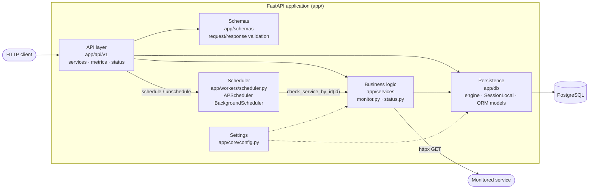
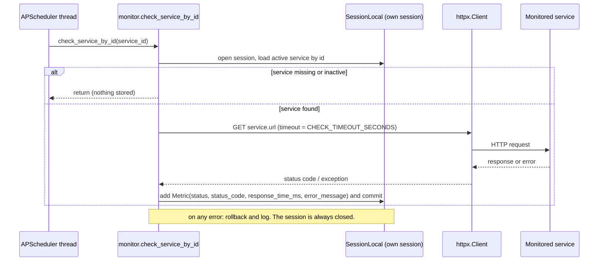

# Architecture

How the Service Monitoring API is built: the components, how one health check travels from the scheduler to a stored metric, and how the aggregated status is derived from those metrics.

## 1. Components

| Component | Location | Responsibility |
|---|---|---|
| API layer | `app/api/v1/` | Thin route handlers: validate input through schemas, load or persist rows, keep the scheduler in sync with service CRUD, return response schemas. |
| Schemas | `app/schemas/` | Pydantic models for every request and response (`ServiceCreate`, `ServiceUpdate`, `ServiceResponse`, `MetricsPage`, `SystemStatus`, ...). |
| Business logic | `app/services/monitor.py` | Runs one HTTP check (`check_service`), runs a scheduled check end to end (`check_service_by_id`), counts recent consecutive failures (`get_consecutive_failures`). |
| | `app/services/status.py` | Aggregates the status of all active services (`get_services_status`). |
| Persistence | `app/db/` | SQLAlchemy 2.0 engine and sync `SessionLocal`, the `get_db` request dependency, and the `Service` and `Metric` ORM models. Schema changes only through Alembic (`migrations/`). |
| Scheduler | `app/workers/scheduler.py` | One APScheduler interval job per active service (`service_<id>`), started and stopped with the app. |
| Settings | `app/core/config.py` | `pydantic-settings` values loaded from the environment / `.env` (see §5). |

### Data model

| Table | Columns (main) | Notes |
|---|---|---|
| `services` | `id`, `name`, `url` (unique), `expected_status` (default 200), `check_interval` seconds (default 60), `is_active` (default true), `created_at` | |
| `metrics` | `id`, `service_id` → `services.id` (`ON DELETE CASCADE`), `status` (`UP`/`DOWN`), `status_code`, `response_time_ms`, `error_message`, `checked_at` (timezone-aware, indexed) | One row per check. Deleting a service deletes its metrics. |

## 2. Lifecycle and scheduler sync

- **Startup** (FastAPI `lifespan`): `start_scheduler()` opens its own `SessionLocal()`, loads every active service, adds one interval job per service (`trigger="interval"`, `seconds=check_interval`, `replace_existing=True`), closes the session and starts the `BackgroundScheduler`. The first check of a job runs one interval after it is scheduled.
- **Shutdown**: `stop_scheduler()` shuts the scheduler down without waiting for running jobs.
- **CRUD keeps jobs in sync** (`app/api/v1/services.py`):

| Request | Scheduler effect |
|---|---|
| `POST /services` | `schedule_service` for the new service |
| `PATCH /services/{id}` | if the service is active after the update: `schedule_service` (replaces the job, picking up a new interval); otherwise `unschedule_service` |
| `DELETE /services/{id}` | `unschedule_service`, then the row (and its metrics) is deleted |

## 3. One health check, step by step

Rules applied by `check_service`:

- **UP** if the response status code equals the service's `expected_status`; otherwise **DOWN** (status code still stored).
- Any exception (connection error, timeout, invalid URL, ...) gives **DOWN** with `status_code = null`, `response_time_ms = null` and the error text truncated to 500 characters.
- `response_time_ms` is measured with a monotonic clock around the request, in milliseconds rounded to 2 decimals.
- `checked_at` is set by the database (`server_default = now()`).

Each job runs in a scheduler background thread, so it opens and closes its **own** session; request sessions (`get_db`) are never shared with jobs. A failing or slow check never reaches the API: the HTTP timeout bounds it and every exception is caught and logged.

## 4. Status derivation (`GET /api/v1/status`)

`get_services_status` looks at **active** services, ordered by `created_at`:

1. A service with **no metrics yet is left out** of the response and is not counted in `total_services`.
2. **UP / DOWN**: `get_consecutive_failures` reads the latest `FAIL_THRESHOLD` metrics (newest first) and counts DOWN metrics until the first UP. The service is **DOWN** if that count reaches `FAIL_THRESHOLD` (that is, the last `FAIL_THRESHOLD` checks all failed), otherwise **UP**. One successful check makes it UP again.
3. **Average response time**: SQL `AVG(response_time_ms)` over **all** of the service's metrics (null values from failed checks are ignored), rounded to 2 decimals; `0.0` when there is no value.
4. **24h uptime**: metrics with `checked_at` in the last 24 hours (UTC); `UP count / total × 100`, rounded to 2 decimals; `0.0` when there are none.
5. `up` and `down` count the included services by derived status; `total_services` is the number of included services.

Metrics for a single service are also exposed through `GET /api/v1/metrics/services/{id}`: newest first, paginated with `limit` (1–1000, default 100) and `offset`, optionally restricted to the last `hours` (1–8760).

## 5. Settings

| Setting | Default | Used by |
|---|---|---|
| `DATABASE_URL` | required | Engine (`app/db/session.py`) and Alembic (`migrations/env.py`) |
| `FAIL_THRESHOLD` | `3` | UP/DOWN rule (§4) |
| `CHECK_TIMEOUT_SECONDS` | `10` | HTTP timeout per check (§3) |

**Known gap:** the default check interval (60 seconds) is a fixed value in the request schema and the ORM model, not a setting. Each service can still set its own `check_interval` (10–86400 seconds).

## 6. Known trade-offs

- **Tests run on SQLite** (in memory) with the scheduler mocked; production runs on PostgreSQL. The default suite builds tables from the models, so it cannot see differences between the migration history and the models. That gap is closed by the `migrations` CI job: `python -m tools.schema_check` compares a database built by `alembic upgrade head` with one built from the models, and `pytest -m postgres` exercises the migrations and the metrics/status endpoints on PostgreSQL. Other Postgres-specific behavior in the rest of the suite is still not covered (roadmap spec 004).
- **Sync SQLAlchemy sessions** in both requests and scheduler threads: simpler than mixing async and threaded code, at the cost of one blocking DB call per operation.
- **Status aggregation queries per service** (latest metric, recent failures, average, 24h window), which is fine for the expected number of services.
