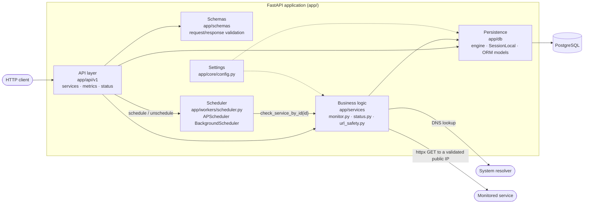
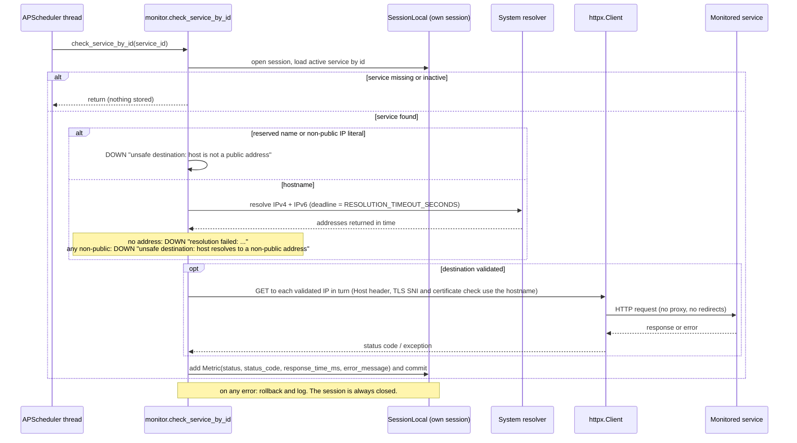

# Architecture

How the Service Monitoring API is built: the components, how one health check travels from the scheduler to a stored metric, and how the aggregated status is derived from those metrics.

## 1. Components



| Component | Location | Responsibility |
|---|---|---|
| API layer | `app/api/v1/` | Thin route handlers: validate input through schemas, run the URL safety check on create/update (§6), load or persist rows, keep the scheduler in sync with service CRUD, return response schemas. |
| Schemas | `app/schemas/` | Pydantic models for every request and response (`ServiceCreate`, `ServiceUpdate`, `ServiceResponse`, `MetricsPage`, `SystemStatus`, ...). |
| Business logic | `app/services/monitor.py` | Runs one HTTP check (`check_service`), runs a scheduled check end to end (`check_service_by_id`), counts recent consecutive failures (`get_consecutive_failures`). |
| | `app/services/status.py` | Aggregates the status of all active services (`get_services_status`). |
| | `app/services/url_safety.py` | URL safety (spec 002, §6): blocked range table, host classification, resolver with a deadline, create/update hostname check, error redaction. |
| Persistence | `app/db/` | SQLAlchemy 2.0 engine and sync `SessionLocal`, the `get_db` request dependency, and the `Service` and `Metric` ORM models. Schema changes only through Alembic (`migrations/`). |
| Scheduler | `app/workers/scheduler.py` | One APScheduler interval job per active service (`service_<id>`), started and stopped with the app. |
| Settings | `app/core/config.py` | `pydantic-settings` values loaded from the environment / `.env` (see §5). |

### Data model

| Table | Columns (main) | Notes |
|---|---|---|
| `services` | `id`, `name`, `url` (unique), `expected_status` (default 200), `check_interval` seconds (default 60), `is_active` (default true), `created_at` | |
| `metrics` | `id`, `service_id` → `services.id` (`ON DELETE CASCADE`), `status` (`UP`/`DOWN`), `status_code`, `response_time_ms`, `error_message`, `checked_at` (timezone-aware, indexed) | One row per check. Deleting a service deletes its metrics. |

## 2. Lifecycle and scheduler sync

- **Startup** (FastAPI `lifespan`): `start_scheduler()` opens its own `SessionLocal()`, loads every active service, adds one interval job per service (`trigger="interval"`, `seconds=check_interval`, `replace_existing=True`), closes the session and starts the `BackgroundScheduler`. The first check of a job runs one interval after it is scheduled.
- **Shutdown**: `stop_scheduler()` shuts the scheduler down without waiting for running jobs.
- **CRUD keeps jobs in sync** (`app/api/v1/services.py`):

| Request | Scheduler effect |
|---|---|
| `POST /services` | `schedule_service` for the new service |
| `PATCH /services/{id}` | if the service is active after the update: `schedule_service` (replaces the job, picking up a new interval); otherwise `unschedule_service` |
| `DELETE /services/{id}` | `unschedule_service`, then the row (and its metrics) is deleted |

## 3. One health check, step by step



Rules applied by `check_service`:

- **UP** if the response status code equals the service's `expected_status`; otherwise **DOWN** (status code still stored).
- Any exception (connection error, timeout, invalid URL, ...) gives **DOWN** with `status_code = null`, `response_time_ms = null` and the error text truncated to 500 characters. Resolved IP addresses in the text are replaced by the hostname.
- A blocked or unresolvable destination (§6) gives **DOWN** the same way, with a fixed message, and no request is sent.
- `response_time_ms` is measured with a monotonic clock from the start of the check (including name resolution) to the response, in milliseconds rounded to 2 decimals.
- `checked_at` is set by the database (`server_default = now()`).

Each job runs in a scheduler background thread, so it opens and closes its **own** session; request sessions (`get_db`) are never shared with jobs. A failing or slow check never reaches the API: the resolution timeout, the shared connect budget and the per-read/write timeout bound it, and every exception is caught and logged.

## 4. Status derivation (`GET /api/v1/status`)

`get_services_status` looks at **active** services, ordered by `created_at`:

1. A service with **no metrics yet is left out** of the response and is not counted in `total_services`.
2. **UP / DOWN**: `get_consecutive_failures` reads the latest `FAIL_THRESHOLD` metrics (newest first) and counts DOWN metrics until the first UP. The service is **DOWN** if that count reaches `FAIL_THRESHOLD` (that is, the last `FAIL_THRESHOLD` checks all failed), otherwise **UP**. One successful check makes it UP again.
3. **Average response time**: SQL `AVG(response_time_ms)` over **all** of the service's metrics (null values from failed checks are ignored), rounded to 2 decimals; `0.0` when there is no value.
4. **24h uptime**: metrics with `checked_at` in the last 24 hours (UTC); `UP count / total × 100`, rounded to 2 decimals; `0.0` when there are none.
5. `up` and `down` count the included services by derived status; `total_services` is the number of included services.

Metrics for a single service are also exposed through `GET /api/v1/metrics/services/{id}`: newest first, paginated with `limit` (1–1000, default 100) and `offset`, optionally restricted to the last `hours` (1–8760).

## 5. Settings

| Setting | Default | Used by |
|---|---|---|
| `DATABASE_URL` | required | Engine (`app/db/session.py`) and Alembic (`migrations/env.py`) |
| `FAIL_THRESHOLD` | `3` | UP/DOWN rule (§4) |
| `CHECK_TIMEOUT_SECONDS` | `10` | Per-read/write timeout of a check, and the connect budget shared by all its connection attempts (§3, §6) |
| `RESOLUTION_TIMEOUT_SECONDS` | `2` | Deadline for resolving a service hostname, IPv4 and IPv6 together, on create/update and before every check (§6). Decimal, `> 0` and `<= 30`; an invalid value stops the app at startup. |

**Known gap:** the default check interval (60 seconds) is a fixed value in the request schema and the ORM model, not a setting. Each service can still set its own `check_interval` (10–86400 seconds).

## 6. URL safety (spec 002)

The API never sends a check to a non-public address, so it cannot be used to probe its own host, the internal network or link-local cloud metadata (SSRF).

**Blocked range table.** Derived from the IANA IPv4/IPv6 Special-Purpose Address Registries ("Globally Reachable = False", as of 2026-11-12); `*` marks additions. A whole block is blocked even where the registry marks a sub-block as reachable.

| IPv4 | | IPv6 | |
|---|---|---|---|
| `0.0.0.0/8` | this network | everything outside `2000::/3` * | `::`, `::1`, `64:ff9b:1::/48`, `100::/64`, `fc00::/7`, `fe80::/10`, `fec0::/10`, `ff00::/8`, ... |
| `10.0.0.0/8`, `172.16.0.0/12`, `192.168.0.0/16` | private | `2001::/23` | IETF assignments, incl. Teredo `2001::/32` |
| `100.64.0.0/10` | shared (CGNAT) | `2001:db8::/32`, `3fff::/20` | documentation |
| `127.0.0.0/8` | loopback | `2002::/16` * | 6to4 |
| `169.254.0.0/16` | link-local, incl. `169.254.169.254` | `5f00::/16` | SRv6 SIDs |
| `192.0.0.0/24` | IETF assignments | | |
| `192.0.2.0/24`, `198.51.100.0/24`, `203.0.113.0/24` | documentation | | |
| `192.88.99.0/24` * | 6to4 relay anycast | | |
| `198.18.0.0/15` | benchmarking | | |
| `224.0.0.0/4` * | multicast | | |
| `240.0.0.0/4` | reserved, incl. `255.255.255.255` | | |

**Embedded-IPv4 forms** are judged by the IPv4 in their last 32 bits: IPv4-mapped `::ffff:0:0/96`, IPv4-compatible `::/96` (except `::` and `::1`), and well-known NAT64 `64:ff9b::/96` * (so DNS64 networks keep working). **Reserved names**: `localhost` and `*.localhost`, with any trailing dots, rejected by name without DNS. All rules apply to the host after URL normalization (lower case, IDNA, IPv4 notations such as `2130706433` or `127.1` rewritten to dotted form).

**On create/update** (`POST /services`, `PATCH /services/{id}` with `url`, even when unchanged):

1. Request validation (`app/schemas/services.py`): a reserved name or non-public IP literal is rejected, together with any other field errors, before the service lookup (so before 404).
2. Handler (`ensure_registration_allowed`): a hostname is resolved after the service lookup and before the duplicate check (so after 404, before 409). Any non-public address rejects the request. A hostname that does not resolve is accepted; every check validates it again. The lookup runs on a worker thread, so the rest of the API keeps answering.

Both rejections return `422` in the request-validation format, with no change to the service or its schedule:

```json
{"detail": [{"type": "url_not_allowed", "loc": ["body", "url"],
             "msg": "Destination not allowed: the URL host is not a public address",
             "input": "<URL as submitted>"}]}
```

**Before every check** (§3) the destination is decided again, so a hostname whose DNS changes after registration (DNS rebinding) is caught:

| Case | Stored check (DOWN, no status code, no response time) |
|---|---|
| Reserved name or non-public IP literal | `unsafe destination: host is not a public address` |
| Hostname with any non-public address | `unsafe destination: host resolves to a non-public address` |
| Hostname with no address within the deadline | `resolution failed: <host>: <timed out / name not found / lookup failed>` |

Otherwise the check connects only to the validated addresses (IPv4 first), trying them until one connects; all attempts share one connect budget (`CHECK_TIMEOUT_SECONDS`), and only TCP-level failures move on to the next address. The `Host` header, TLS SNI and certificate verification keep the original hostname. Redirects are never followed. Proxy settings and `.netrc` from the environment are ignored; custom CA settings (`SSL_CERT_FILE`, `SSL_CERT_DIR`) are still honored. Error texts never contain a resolved IP address.

Existing services are never changed, deactivated or deleted because of their URL: a stored unsafe service stays scheduled and its checks are recorded as blocked (DOWN). Not covered: an allow-list for private networks, provider endpoints on public addresses (for example `168.63.129.16`), checks through a proxy.

## 7. Known trade-offs

- **Tests run on SQLite** (in memory) with the scheduler mocked; production runs on PostgreSQL. The default suite builds tables from the models, so it cannot see differences between the migration history and the models. That gap is closed by the `migrations` CI job: `python -m tools.schema_check` compares a database built by `alembic upgrade head` with one built from the models, and `pytest -m postgres` exercises the migrations and the metrics/status endpoints on PostgreSQL. Other Postgres-specific behavior in the rest of the suite is still not covered (roadmap spec 005).
- **Sync SQLAlchemy sessions** in both requests and scheduler threads: simpler than mixing async and threaded code, at the cost of one blocking DB call per operation.
- **Status aggregation queries per service** (latest metric, recent failures, average, 24h window), which is fine for the expected number of services.
- **Name resolution with abandoned threads**: each lookup runs `getaddrinfo` in a daemon thread with a deadline. A lookup that outlives the deadline keeps its thread until the system resolver gives up; its result is discarded. This honors every name source the OS uses (hosts file, container DNS) without a new dependency.
- **The default test suite is offline**: an autouse guard blocks DNS and non-loopback connections, and a fake resolver answers every hostname with a public address unless a test says otherwise.
