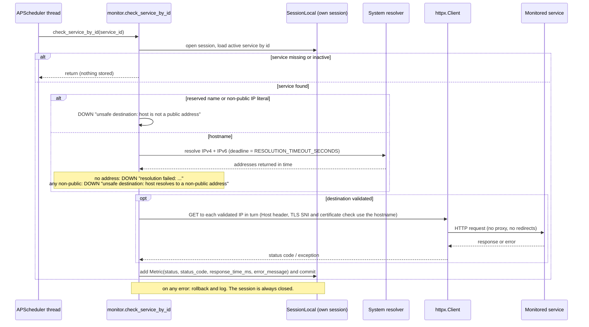

# Architecture

How the Service Monitoring API is built: the components, how one health check travels from the scheduler to a stored metric, and how the aggregated status is derived from those metrics.

## 1. Components


| Component | Location | Responsibility |
|---|---|---|
| API layer | `app/api/v1/` | Thin route handlers: validate input through schemas, run the URL safety check on create/update (§6), load or persist rows, keep the scheduler in sync with service CRUD, return response schemas. |
| Schemas | `app/schemas/` | Pydantic models for every request and response (`ServiceCreate`, `ServiceUpdate`, `ServiceResponse`, `MetricsPage`, `SystemStatus`, ...). |
| Business logic | `app/services/monitor.py` | Runs one HTTP check (`check_service`), runs a scheduled check end to end (`check_service_by_id`), counts recent consecutive failures (`get_consecutive_failures`). |
| | `app/services/status.py` | Aggregates the status of all active services (`get_services_status`). |
| | `app/services/url_safety.py` | URL safety (spec 002, §6): blocked range table, host classification, resolver with a deadline, create/update hostname check, error redaction. |
| Persistence | `app/db/` | SQLAlchemy 2.0 engine and sync `SessionLocal`, the `get_db` request dependency, and the `Service` and `Metric` ORM models. Schema changes only through Alembic (`migrations/`). |
| Scheduler | `app/workers/scheduler.py` | One APScheduler interval job per active service (`service_<id>`), started and stopped with the app. |
| Settings | `app/core/config.py` | `pydantic-settings` values loaded from the environment / `.env` (see §5). |

### Data model

| Table | Columns (main) | Notes |
|---|---|---|
| `services` | `id`, `name`, `url` (unique), `expected_status` (default 200), `check_interval` seconds (default 60), `is_active` (default true), `created_at` | |
| `metrics` | `id`, `service_id` → `services.id` (`ON DELETE CASCADE`), `status` (`UP`/`DOWN`), `status_code`, `response_time_ms`, `error_message`, `checked_at` (timezone-aware, indexed) | One row per check. Deleting a service deletes its metrics. |

## 2. Lifecycle and scheduler sync

- **Startup** (FastAPI `lifespan`): `start_scheduler()` opens its own `SessionLocal()`, loads every active service, adds one interval job per service (`trigger="interval"`, `seconds=check_interval`, `replace_existing=True`), closes the session and starts the `BackgroundScheduler`. The first check of a job runs one interval after it is scheduled (seeded demo services also get an immediate first check, §7).
- **Shutdown**: `stop_scheduler()` shuts the scheduler down without waiting for running jobs.
- **CRUD keeps jobs in sync** (`app/api/v1/services.py`):

| Request | Scheduler effect |
|---|---|
| `POST /services` | `schedule_service` for the new service |
| `PATCH /services/{id}` | if the service is active after the update: `schedule_service` (replaces the job, picking up a new interval); otherwise `unschedule_service` |
| `DELETE /services/{id}` | the row (and its metrics) is deleted, then `unschedule_service` |

## 3. One health check, step by step



Rules applied by `check_service`:

- **UP** if the response status code equals the service's `expected_status`; otherwise **DOWN** (status code still stored).
- Any exception (connection error, timeout, invalid URL, ...) gives **DOWN** with `status_code = null`, `response_time_ms = null` and the error text truncated to 500 characters. Resolved IP addresses in the text are replaced by the hostname.
- A blocked or unresolvable destination (§6) gives **DOWN** the same way, with a fixed message, and no request is sent.
- `response_time_ms` is measured with a monotonic clock from the start of the check (including name resolution) to the response, in milliseconds rounded to 2 decimals.
- `checked_at` is set by the database (`server_default = now()`).

Each job runs in a scheduler background thread, so it opens and closes its **own** session; request sessions (`get_db`) are never shared with jobs. A failing or slow check never reaches the API: the resolution timeout, the shared connect budget and the per-read/write timeout bound it, and every exception is caught and logged.

## 4. Status derivation (`GET /api/v1/status`)

`get_services_status` looks at **active** services, ordered by `created_at`:

1. A service with **no metrics yet is left out** of the response and is not counted in `total_services`.
2. **UP / DOWN**: `get_consecutive_failures` reads the latest `FAIL_THRESHOLD` metrics (newest first) and counts DOWN metrics until the first UP. The service is **DOWN** if that count reaches `FAIL_THRESHOLD` (that is, the last `FAIL_THRESHOLD` checks all failed), otherwise **UP**. One successful check makes it UP again.
3. **Average response time**: SQL `AVG(response_time_ms)` over **all** of the service's metrics (null values from failed checks are ignored), rounded to 2 decimals; `0.0` when there is no value.
4. **24h uptime**: metrics with `checked_at` in the last 24 hours (UTC); `UP count / total × 100`, rounded to 2 decimals; `0.0` when there are none.
5. `up` and `down` count the included services by derived status; `total_services` is the number of included services.

Metrics for a single service are also exposed through `GET /api/v1/metrics/services/{id}`: newest first, paginated with `limit` (1–1000, default 100) and `offset`, optionally restricted to the last `hours` (1–8760).

## 5. Settings

| Setting | Default | Used by |
|---|---|---|
| `DATABASE_URL` | required | Engine (`app/db/session.py`) and Alembic (`migrations/env.py`) |
| `FAIL_THRESHOLD` | `3` | UP/DOWN rule (§4) |
| `CHECK_TIMEOUT_SECONDS` | `10` | Per-read/write timeout of a check, and the connect budget shared by all its connection attempts (§3, §6) |
| `RESOLUTION_TIMEOUT_SECONDS` | `2` | Deadline for resolving a service hostname, IPv4 and IPv6 together, on create/update and before every check (§6). Decimal, `> 0` and `<= 30`; an invalid value stops the app at startup. |

**Known gap:** the default check interval (60 seconds) is a fixed value in the request schema and the ORM model, not a setting. Each service can still set its own `check_interval` (10–86400 seconds).

## 6. URL safety (spec 002)

The API never sends a check to a non-public address, so it cannot be used to probe its own host, the internal network or link-local cloud metadata (SSRF).

**Blocked range table.** Derived from the IANA IPv4/IPv6 Special-Purpose Address Registries ("Globally Reachable = False", as of 2026-11-12); `*` marks additions. A whole block is blocked even where the registry marks a sub-block as reachable.

| IPv4 | | IPv6 | |
|---|---|---|---|
| `0.0.0.0/8` | this network | everything outside `2000::/3` * | `::`, `::1`, `64:ff9b:1::/48`, `100::/64`, `fc00::/7`, `fe80::/10`, `fec0::/10`, `ff00::/8`, ... |
| `10.0.0.0/8`, `172.16.0.0/12`, `192.168.0.0/16` | private | `2001::/23` | IETF assignments, incl. Teredo `2001::/32` |
| `100.64.0.0/10` | shared (CGNAT) | `2001:db8::/32`, `3fff::/20` | documentation |
| `127.0.0.0/8` | loopback | `2002::/16` * | 6to4 |
| `169.254.0.0/16` | link-local, incl. `169.254.169.254` | `5f00::/16` | SRv6 SIDs |
| `192.0.0.0/24` | IETF assignments | | |
| `192.0.2.0/24`, `198.51.100.0/24`, `203.0.113.0/24` | documentation | | |
| `192.88.99.0/24` * | 6to4 relay anycast | | |
| `198.18.0.0/15` | benchmarking | | |
| `224.0.0.0/4` * | multicast | | |
| `240.0.0.0/4` | reserved, incl. `255.255.255.255` | | |

**Embedded-IPv4 forms** are judged by the IPv4 in their last 32 bits: IPv4-mapped `::ffff:0:0/96`, IPv4-compatible `::/96` (except `::` and `::1`), and well-known NAT64 `64:ff9b::/96` * (so DNS64 networks keep working). **Reserved names**: `localhost` and `*.localhost`, with any trailing dots, rejected by name without DNS. All rules apply to the host after URL normalization (lower case, IDNA, IPv4 notations such as `2130706433` or `127.1` rewritten to dotted form).

**On create/update** (`POST /services`, `PATCH /services/{id}` with `url`, even when unchanged):

1. Request validation (`app/schemas/services.py`): a reserved name or non-public IP literal is rejected, together with any other field errors, before the service lookup (so before 404).
2. Handler (`ensure_registration_allowed`): a hostname is resolved after the service lookup and before the duplicate check (so after 404, before 409). Any non-public address rejects the request. A hostname that does not resolve is accepted; every check validates it again. The lookup runs on a worker thread, so the rest of the API keeps answering.

Both rejections return `422` in the request-validation format, with no change to the service or its schedule:

```json
{"detail": [{"type": "url_not_allowed", "loc": ["body", "url"],
             "msg": "Destination not allowed: the URL host is not a public address",
             "input": "<URL as submitted>"}]}
```

**Before every check** (§3) the destination is decided again, so a hostname whose DNS changes after registration (DNS rebinding) is caught:

| Case | Stored check (DOWN, no status code, no response time) |
|---|---|
| Reserved name or non-public IP literal | `unsafe destination: host is not a public address` |
| Hostname with any non-public address | `unsafe destination: host resolves to a non-public address` |
| Hostname with no address within the deadline | `resolution failed: <host>: <timed out / name not found / lookup failed>` |

Otherwise the check connects only to the validated addresses (IPv4 first), trying them until one connects; all attempts share one connect budget (`CHECK_TIMEOUT_SECONDS`), and only TCP-level failures move on to the next address. The `Host` header, TLS SNI and certificate verification keep the original hostname. Redirects are never followed. Proxy settings and `.netrc` from the environment are ignored; custom CA settings (`SSL_CERT_FILE`, `SSL_CERT_DIR`) are still honored. Error texts never contain a resolved IP address.

Existing services are never changed, deactivated or deleted because of their URL: a stored unsafe service stays scheduled and its checks are recorded as blocked (DOWN). Not covered: an allow-list for private networks, provider endpoints on public addresses (for example `168.63.129.16`), checks through a proxy.

## 7. Demo mode (spec 003a)

Demo mode lets the API run as a demo with example services that visitors can look at but not change, plus a small, capped space where visitors can add their own services. It is off by default. **On its own it is not enough for a public deployment:** specs 003b (rate limiting), 003c (periodic reset) and 003d (single-process lock) are needed too.

### Settings

`DEMO_MODE` is always read. The other settings are read and validated only while it is on, so a malformed value never matters while demo mode is off. Any invalid value stops startup, and every error is reported at once, naming the variable.

| Setting | Default | Valid values |
|---|---|---|
| `DEMO_MODE` | off | `true`, `1`, `yes`, `on` / `false`, `0`, `no`, `off` (any case). Unset means off; anything else, including an empty value, stops startup |
| `DEMO_SEED_SERVICES` | required | JSON array of 1 to 20 seed definitions (below) |
| `DEMO_GLOBAL_VISITOR_CAP` | `20` | Integer 1–1000 |
| `DEMO_PER_HOST_VISITOR_CAP` | `3` | Integer 1–1000, not greater than the global cap (the error names both variables) |
| `DEMO_MIN_CHECK_INTERVAL_SECONDS` | `300` | Integer 10–86400 |

**Seed definition**: `{"name": ..., "url": ..., "expected_status": ..., "check_interval": ...}`. `name` (1–100 characters) and `url` are required; `expected_status` (100–599) and `check_interval` (10–86400, the demo minimum does not apply) are optional and default to the API's defaults. The URL follows the API's own rules and must not contain user information. Unknown keys, wrong JSON types (for example `"60"` or `true` for a number) and two definitions with the same normalized URL are errors. Errors name `DEMO_SEED_SERVICES` and the definition by its 1-based position (plus its name when the name is valid), and never contain credentials or resolved addresses. Duplicate names are allowed.

### Service origin

Every service stores an `origin` (column `services.origin`, migration `30fbc6a1211a`): `seeded`, `visitor` or `ordinary`. Existing services became `ordinary`. When demo mode is turned on, every service that isn't a visitor or seeded service is therefore ordinary and protected; services kept from an earlier demo period keep their origin. With demo mode off nothing is seeded, capped or protected, and origins are kept.

### Startup

1. Load and validate the settings, then check every seed URL with the spec 002 rules (§6). All seed hostnames are resolved at the same time, so this takes about one `RESOLUTION_TIMEOUT_SECONDS`. A hostname resolving to a non-public address stops startup; an unresolvable one is accepted.
2. Seed in one transaction (`app/services/demo_seeding.py`), matching services by normalized URL:
   - a missing seed is created;
   - a stored service with the seed's normalized URL is adopted whatever its origin: name, expected status and interval are corrected, it is reactivated, origin becomes `seeded`, and its checks are kept. If several match (legacy forms of one URL), the lowest id is adopted and the others are logged as a warning;
   - a `seeded` service whose URL is no longer in the list becomes `ordinary`;
   - a stored URL that can't be parsed matches nothing and is logged.

   Any failure stops startup; the API never serves half-seeded.
3. Start the scheduler as usual (§2), plus one immediate first check per seeded service (`first_check_<id>`, a one-off job with `misfire_grace_time=None`). These are never skipped as late, even when 20 slow seeds wait for the 10 check workers. All other jobs keep the scheduler defaults.

Seeded services get no generated, backfilled or altered metrics; their history comes only from real checks.

### Writes while demo mode is on

| Service | `PATCH` / `DELETE` |
|---|---|
| seeded | `403 {"detail": "Seeded demo services cannot be changed."}`, even for an empty body |
| ordinary | `403 {"detail": "This service cannot be changed while demo mode is on."}` |
| visitor | allowed to anyone (there are no accounts) |

- **Create**: the new service has origin `visitor`. Without `check_interval` it gets the demo minimum (default 300) instead of 60.
- **Minimum interval**: a `check_interval` below the demo minimum on create, or on an update of a visitor service (even if equal to the current value), gives `422` with one entry: `{"type": "demo_interval_too_low", "loc": ["body", "check_interval"], "msg": "In demo mode the check interval must be at least 300 seconds", "input": <value>}`. A value outside 10–86400 fails request validation first.
- **Caps** (`409`): a create when visitor services are at the global cap: `Demo limit reached: at most <G> visitor services at a time.` A create, or an update that changes a visitor service's cap host, when the other visitor services on that host are at the per-host cap: `Demo limit reached: at most <H> visitor services for host <host>.` The **cap host** is the URL's host, lower-cased, without brackets, port or trailing dot (`http://example.com/` and `https://EXAMPLE.com.:8443/x` share one). Seeded and ordinary services don't count. If the owner lowers a cap, services already above it stay.
- **Atomic caps**: caps are checked before the hostname lookup and checked again in the transaction that stores the change, serialized with a PostgreSQL transaction-level advisory lock (`pg_advisory_xact_lock`), with no network lookup inside it. No concurrency of requests, even across several processes, adds a visitor service beyond a cap.

**Error order** (the first that applies wins; a rejected request changes nothing, schedule included):

- Create: 422 request validation (including spec 002's literal check) → 422 demo minimum interval → 409 global cap → (409 per-client cap, spec 003b) → 409 per-host cap → 422 spec 002 hostname check → 409 duplicate URL.
- Update: 422 request validation → 404 → 403 → 422 demo minimum interval → 409 per-host cap → 422 spec 002 hostname check → 409 duplicate URL.
- Delete: 422 request validation → 404 → 403.

The only exception is a race: a cap filled by another request during the hostname lookup gives the cap 409 from the re-check.

### Changes that apply with demo mode off too

- **Duplicate URL is always 409** `{"detail": "A service with this URL already exists"}`, on create and update. Normalized URLs are compared first, which also catches legacy rows stored in another form (`http://Example.com`); a race is caught by the unique index on commit and reported the same way. Other database errors are not reported as duplicates, and an update keeping its own URL is fine. Before, a duplicate on update gave 500.
- **`null` on a required field in `PATCH`** (`name`, `url`, `expected_status`, `check_interval`, `is_active`) gives 422 with one entry per field, `{"type": "null_not_allowed", "msg": "<field> cannot be null", ...}`, instead of 500.
- Scheduling happens only after a successful commit, so a failed update or delete leaves the schedule as it was.

### Edge cases

- A visitor service on a seeded service's URL: 409 duplicate. On a seeded service's host: allowed up to the per-host cap.
- A transient DNS answer making a seed resolve to a non-public address stops startup; restart once DNS is correct.
- Restarts never duplicate seeds or reset their history, and each restart gives seeds an immediate check.

## 8. Known trade-offs

- **Tests run on SQLite** (in memory) with the scheduler mocked; production runs on PostgreSQL. The default suite builds tables from the models, so it cannot see differences between the migration history and the models. That gap is closed by the `migrations` CI job: `python -m tools.schema_check` compares a database built by `alembic upgrade head` with one built from the models, and `pytest -m postgres` exercises the migrations, the metrics/status endpoints and the demo caps and duplicate detection under concurrency on PostgreSQL. Other Postgres-specific behavior in the rest of the suite is still not covered (roadmap spec 006).
- **Sync SQLAlchemy sessions** in both requests and scheduler threads: simpler than mixing async and threaded code, at the cost of one blocking DB call per operation.
- **Status aggregation queries per service** (latest metric, recent failures, average, 24h window), which is fine for the expected number of services.
- **Name resolution with abandoned threads**: each lookup runs `getaddrinfo` in a daemon thread with a deadline. A lookup that outlives the deadline keeps its thread until the system resolver gives up; its result is discarded. This honors every name source the OS uses (hosts file, container DNS) without a new dependency.
- **The default test suite is offline**: an autouse guard blocks DNS and non-loopback connections, and a fake resolver answers every hostname with a public address unless a test says otherwise.
